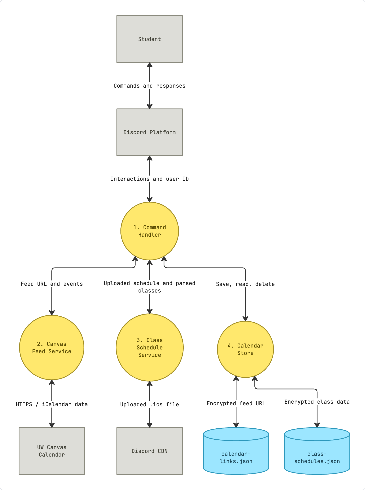
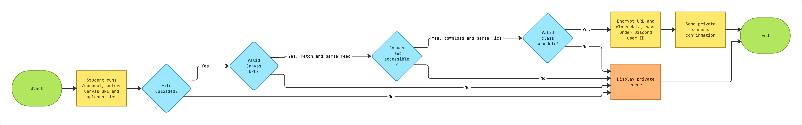
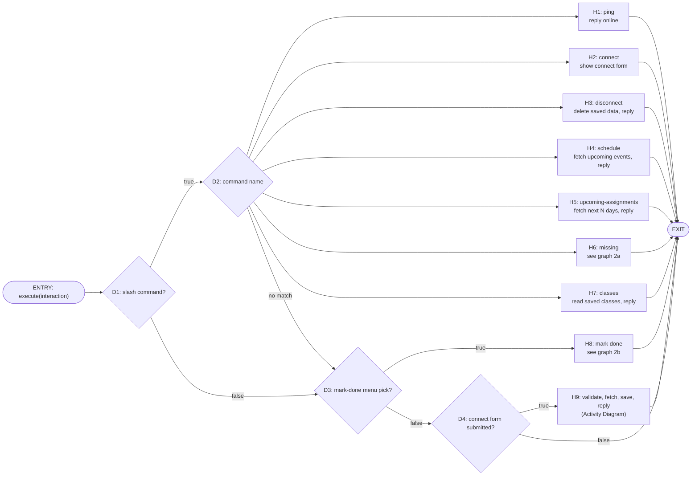
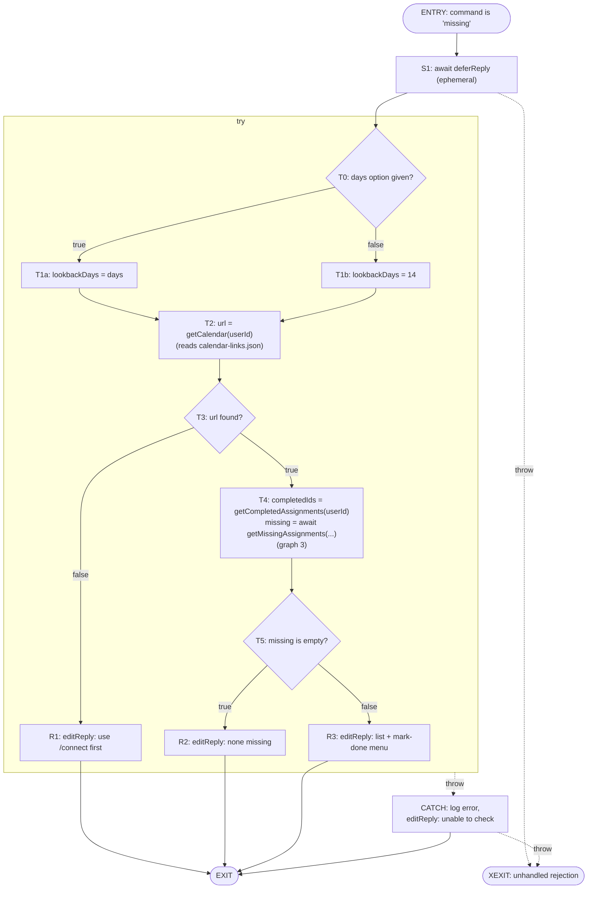
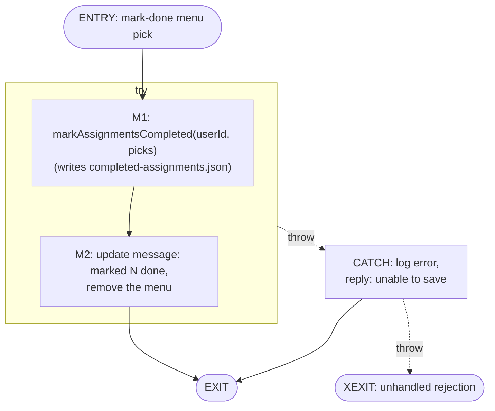
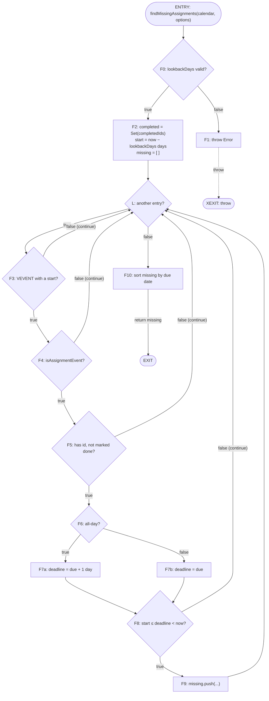

# Calendeers Architecture Documentation

## Data Flow Diagram: 

The data flow diagram shows how Calendeers transfers calendar and class-schedule information between the student, Discord, its internal services, and local storage. A student sends commands through Discord, which passes the interaction and Discord user ID to the command handler (`src/events/interactionCreate.js`). The handler coordinates the services responsible for fetching calendar events, importing class schedules as well as accessing saved data.

The diagram identifies three main data-processing paths:

1. **Canvas calendar:** The Canvas Feed Service (`src/services/canvasFeed.js`) uses the student's calendar feed URL to retrieve iCalendar (`.ics`) events from UW Canvas over HTTPS. It passes parsed calendar information back to the command handler.
2. **Register.UW class schedule:** The Class Schedule Service (`src/services/classSchedule.js`) processes an `.ics` schedule file uploaded by the student through Discord. The file is retrieved from Discord's content delivery network (CDN), parsed and then returned as class data. The bot does not request the schedule directly from Register.UW.
3. **Local calendar storage:** The Calendar Store (`src/services/calendarStore.js`) associates saved calendar information with the student's Discord user ID. It encrypts and saves the Canvas feed URL in `calendar-links.json` and class-schedule data in `class-schedules.json`, and retrieves or deletes this information when the appropriate command is called.

In this diagram, **rectangles** indicate outside actors or systems, **circles** indicate processing components inside Calendeers, and **cylinders** indicate local files used to store data. The arrows show information exchanged between these elements, including command responses to the student.

## Activity Diagram: 

The activity diagram illustrates the `/connect` workflow when a student supplies both a UW Canvas calendar feed URL and a Register.UW `.ics` schedule file. It emphasizes the order of actions, validation decisions, successful storage, and error handling.

The workflow is as follows:

1. **Start:** The student runs `/connect`, enters a Canvas calendar feed URL, and uploads a Register.UW `.ics` file.
2. **Validate the inputs:** Calendeers checks that a file was uploaded and that the Canvas URL is valid. If either check fails, the workflow follows the private-error path.
3. **Retrieve Canvas data:** The bot attempts to access and parse the Canvas calendar feed. An inaccessible or invalid feed leads to a private error.
4. **Import the class schedule:** The bot downloads the uploaded `.ics` file and parses its course information. If the schedule cannot be validated, the workflow ends with a private error.
5. **Save the connection:** If all checks succeed, Calendeers encrypts the feed URL and parsed class data and stores them under the student's Discord user ID.
6. **Confirm:** The bot sends the student a private success message and the activity ends.

The **green shapes** mark the beginning and end, **yellow rectangles** represent actions, **blue diamonds** show decisions, and the **orange rectangle** represents the error outcome. This diagram documents the path with both inputs; it does not attempt to model other possible forms of `/connect` invocation.

**Related implementation:** `src/events/interactionCreate.js`, `src/services/canvasFeed.js`, `src/services/classSchedule.js`, and `src/services/calendarStore.js`.

## Use Case Diagram: 

Add description and diagram here

## System Context Diagram: 

Add description and diagram here

## Network Diagram: 

Add description and diagram here

## Control-Flow Diagram: 

A control-flow graph (CFG) shows the paths execution can take through a piece of code. Each node is a **basic block**, a run of statements that always execute together, and each edge is a possible jump from one block to the next. The four graphs below zoom in step by step:
- **Graph 1:** the handler that receives every slash command, select-menu pick, and modal submission.
- **Graphs 2a and 2b:** one feature, `/missing`.
- **Graph 3:** the loop that decides whether an assignment is missing.

How to read the graphs:
- **Rounded boxes** are the graph's `ENTRY` and `EXIT` nodes.
- **Rectangles** are basic blocks.
- **Diamonds** are blocks that end in a branch. Their outgoing edges are labeled with the branch outcome.
- **Dashed edges** are exceptional control flow: a thrown error jumping to a `catch` block or out of the function.
- Each node's label starts with an ID (such as `D3`) that the text below refers to.

Three simplifications keep the graphs readable:
- **Graph 1 is condensed.** Each command handler is collapsed into one node, and graphs 2a and 2b expand two of them to the basic-block level.
- **Compound conditions are one decision.** A condition joined by `&&` or `||` is drawn as a single diamond. Its parts have no side effects, so the outcomes are the same as drawing each part separately.
- **Conditions are phrased positively.** For example, "url found?" stands for code that tests `!url` and returns early.

### 1. Interaction dispatch: `execute()` in `src/events/interactionCreate.js`

When the bot starts, `src/helpers/loadEvents.js` registers each file in the `events` folder as a Discord event listener. Slash commands, select-menu picks, and modal submissions all arrive as one event, `interactionCreate`, so this `execute()` function is their single entry point. Plain chat messages, such as `!help`, are a separate event handled by `messageCreate.js`.

The full conditions are:
- **`D3`:** `interaction.isStringSelectMenu() && interaction.customId === "missing_mark_done"`
- **`D4`:** `interaction.isModalSubmit() && interaction.customId === "connect_calendar"`

In the code, the seven `if (command === "...")` tests run one after another, and `D2` draws them as one multi-way branch. Each command handler ends in `return`, so at most one handler runs for any interaction. An interaction that matches nothing reaches `EXIT` without a reply.

Some features take two separate interactions, such as `/connect` followed by its form, or `/missing` followed by its menu. The first response (a form or a menu) carries a `customId`. When the follow-up interaction arrives, `D3` or `D4` uses that `customId` to route it back to the right code.

Some calls run outside any `try` block, so their errors are not drawn in graph 1:
- `/ping` and `/connect` have no `try` at all.
- `/disconnect` has no `try` either; it reads and rewrites the saved-data files directly.
- Every handler that calls `deferReply()` does so before its `try`.

An error thrown by any of these calls leaves `execute()` as an unhandled promise rejection. The bot has no handler for unhandled rejections, and on Node 18 (the version in the `Dockerfile`) one stops the process. Graph 2a draws this path as `XEXIT`.

**Adding a new slash command:**
1. Add its name, description, and options to the `commands` array in `src/events/ready.js`. This array is registered with every server the bot is in when it starts.
2. Add an `if (command === "...")` handler to `execute()` that replies and then `return`s.
3. Put Canvas, schedule, or storage logic in `src/services/`, where it can be tested without Discord.

If the handler makes a network request, it should call `deferReply()` first, because Discord expects a response to an interaction within 3 seconds.

### 2. The `/missing` command and its "mark as done" menu

**2a. `/missing` handler** (`H6` in graph 1):

**2b. Mark-done handler** (`H8` in graph 1). It runs later, as a new interaction, when the student picks items from the menu that `R3` sent:

How graph 2a behaves:
- **Private replies.** `S1` makes the reply ephemeral, so `R1`, `R2`, `R3`, and `CATCH` are seen only by the student who ran the command.
- **One error path.** Everything after `S1` sits inside one `try`, including the replies themselves. So any error there ends at `CATCH` with one generic message, and the details go to the console log. Possible errors include:
  - a timed-out request
  - a response that is not a calendar
  - an unreadable data file
  - a missing encryption key
- **Message limits.** `R3` trims the list to fit Discord's 2000-character message limit and the menu to Discord's 25-option limit.

There is no edge from `R3` to graph 2b. The menu reply ends the first interaction, and the student's pick arrives later as a new `interactionCreate` event, which `D3` in graph 1 routes to `H8`.

### 3. Deciding what is missing: `findMissingAssignments()` in `src/services/canvasFeed.js`

A Canvas `.ics` feed lists due dates but not whether anything was submitted, so the bot cannot ask Canvas what is missing. Instead, an assignment counts as missing when all three are true:
- it was due within the look-back window,
- its deadline has passed, and
- the student has not marked it done.

`getMissingAssignments()` downloads and parses the feed, and throws if the response is not an iCalendar file. It then calls this function, which checks those rules against each calendar entry:

Each `continue` in the code is a back edge to the loop test `L`, so an entry that fails any check is skipped. The function has one normal exit (`EXIT`) and one exceptional exit (`XEXIT`).

Four rules sit behind these branches:
- **`F4`, which entries are assignments:** an entry counts as an assignment if its title starts with `Assignment:` or its URL contains `/assignments/` or `/quizzes/`. This filters out lectures and other events.
- **`F6`/`F7a`, all-day entries:** an all-day assignment gets one extra day, so it counts as missing only after its due date has fully passed.
- **`F8`, the look-back window:** this skips assignments that are not yet due, and those older than the window.
- **`F9`, links:** the assignment's link is kept only if it points to `https://canvas.uw.edu`, so the bot never posts an arbitrary link from the feed.

This function makes no network calls and touches no files. `tests/missingAssignments.spec.js` can therefore test it with a small hand-written `.ics` feed and a fixed `now`.

**Related implementation:** `src/events/interactionCreate.js`, `src/events/ready.js`, `src/helpers/loadEvents.js`, `src/services/canvasFeed.js`, `src/services/calendarStore.js`, and `tests/missingAssignments.spec.js`.

## Class Diagram: 

Add description and diagram here